PressUp is a fitness app for workout tracking and guided programmes, with a website that sells it. It's for everyone from first-timers to committed lifters, so the brand works in two registers: **loud brand moments** that look like the posters, and **calm working screens** for when someone is mid-set with a barbell in their hands.

## Voice

The tagline is **Challenge • Motivate • Succeed**. Every piece of copy should do one of those three.

- **Headlines** are short, imperative, all caps in Anton, and end with a full stop: "TAKE THE FIRST STEP." "FOCUS." "LOCKED IN". One to four words.
- **Values** go in brackets: `[ DISCIPLINE ]`. One word, used as a programme name or weekly theme.
- **Body copy** is plain, second person, encouraging. Say what to do and why: "Lower the bar to mid-chest, pause, then press." Don't shame. The posters' "separates winners from losers" is fine for a campaign, but never in the app.
- **Coaching cues** are imperative and physical: "Brace. Drive through your heels."
- Use British English. Units are kg, km and min. Sets × reps are written "4 × 8" with a multiplication sign. Numbers are always figures.
- Buttons are verbs: "Start workout", "Log set", "Join programme". No exclamation marks, no emoji.
- In running text the name is **PressUp**. The wordmark is the only place it appears as PRESSUP.

## Two registers

| | Brand moments | Working screens |
|---|---|---|
| Where | Website, onboarding, splash, workout complete, new PR, programme start, social | Today, workout logging, rest timer, history, settings |
| Type | `display-xl` / `display-l`, `EchoHeadline`, `BracketTitle` | One `display-m` or `heading` per screen, then `title`, `body`, `stat` |
| Colour | Black, black-and-white photography, lots of yellow type | `surface` and `surface-raised`; yellow only for the primary action, progress and the current set |
| Graphics | `Rings`, the figures pattern, photography | None. Content only. |

When in doubt, a screen someone uses mid-workout is a working screen.

## Colour

- **Dark is the default theme** and matches the posters. Light exists for the in-app setting and for accessibility, and is a full theme, not an afterthought. The website is dark only.
- `press-yellow` is the brand. On working screens it covers no more than about 10% of the screen: the primary `Button`, the active tab, `ProgressRing` arcs, `pr` badges. On brand moments it can carry all the type.
- Text and icons on a `press-yellow` fill are always `on-yellow`, never white.
- For yellow as text, use `accent`, not `press-yellow`. Raw yellow on a light ground is only 1.2:1, so on light `accent` is ink and sits on a yellow fill instead: `accent-highlight` behind bracket titles, `accent-soft` behind the current set, highlighted stats and the active tab. Yellow stays the lead colour in both themes.
- `EchoHeadline` is the exception: it stays press-yellow in both themes, just on the light ground. It's decorative brand type, so never let it carry information on its own.
- Progress arcs use `accent-line` (press-yellow in both themes) over `ring-track`, which is dark on light so the arc reads.
- Status: `success` (teal) and `danger` (coral) are told apart by lightness and hue, never colour alone. Every status also carries an icon or a word (`Badge` does this for you).
- Neutrals carry a slight warm-yellow bias (`line`, `ink-muted`) so greys sit with the yellow instead of looking cold.

## Type

Three Google Fonts, chosen to match the posters:

- **Anton** (`--font-display`) is the condensed poster headline face, always uppercase. `display-xl` to `heading`. Never below 22px, and never for more than one line of a sentence.
- **Barlow Condensed** (`--font-condensed`) is for anything counted or pressed. `stat-xl` and `stat` for numbers (always `font-variant-numeric: tabular-nums` so values don't jump as they change). `label` for buttons, tabs and the tagline. `overline` for eyebrows and units. Labels are uppercase with letter-spacing.
- **Jost** (`--font-sans`) is the geometric body face, close to the posters' paragraph copy. `title`, `body`, `body-sm`, `caption`. Sentence case.

If the brand later licenses its own faces (e.g. Helvetica Neue Condensed and Avenir Next), swap the three family stacks and keep the style names.

## Graphic devices

All of these come from the posters. Use them only in brand moments.

- **Rings** (`Rings`): two to four concentric hairlines in `accent` at `ring-faint`, centred on the subject.
- **Brackets** (`BracketTitle`): `[ ONE WORD ]`.
- **Echo** (`EchoHeadline`): a headline repeated and fading through `echo-1`…`echo-5`, with a cut-out athlete crossing it.
- **Blur echo**: on posters, a large blurred word behind a small sharp one ("FOCUS."). It's print and social only; don't use it in UI.
- **The ring dot** separates words in the tagline and metadata. It's the logo's head, never a plain bullet.
- **Figures pattern** (assets → Graphics): onboarding, empty states, footer, merch.

## Logo

See assets → Logos. Use `pressup-wordmark-on-dark` by default. On light surfaces use `on-light` at 32px tall or more, and `mono-black` below that. Keep clear space equal to the ring's height. The P mark alone is the app icon: yellow arc and white P on `#0a0a0a`.

## Shape, space, depth

- Controls are pills (`radius-pill`), echoing the logo's round caps. Cards use `radius-md`, sheets and programme cards `radius-lg`, inputs and set rows `radius-sm`.
- Spacing is on a 4px base. On phones, gutters are `space-5` and sections `space-6`–`space-8` apart. On the web, gutters are `space-10`, sections `space-16` apart, and content is at most 1200px wide.
- Separate things with surface steps (`surface` → `surface-raised` → `surface-sunken`), not borders or shadows. `shadow-float` is only for things that float: the tab bar, sheets and the timer overlay.
- Lines are `stroke-hairline` for rings and dividers, `stroke-icon` for icons and `stroke-ring` for progress arcs, all with round caps.

## Motion

Quick and physical: 120–200ms ease-out for presses and toggles, and 400ms for a progress arc filling. Celebrate a PR with one moment (the arc completes, the badge scales in), not confetti. Never loop decorative motion. With `prefers-reduced-motion`, swap movement for an instant change.

## Iconography

The brand had no icon set, so `Icon` is a small set drawn to match the logo: 24px grid, 2px stroke, round caps and joins, `currentColor`. When you need an icon it doesn't have, use **Lucide** at `stroke-width: 2` with round caps. It's the closest public match. This is a substitute, so flag new icons for review. No emoji, and no filled icon styles.

## Accessibility

- Every text token's note names the grounds it's checked on, at 4.5:1 or better in both themes. Control borders (`line-strong`) are 3:1.
- Focus is `focus-ring`: a solid 2px outline 2px off the element, yellow on dark and ink on light.
- Tap targets are at least 40px; in-workout controls are 48px or more.
- Status is never colour alone.

## Using this system

Components are React 18 function components on `window.PressUp` (`components/bundle.js`), styled by `components/bundle.css`, which also loads the three Google Fonts. Tokens are CSS custom properties (`--surface`, `--accent`, `--space-5`, `--radius-pill`…) with `dark` as the default theme and `light` under `[data-theme="light"]`. The example screens (TodayScreen, WorkoutScreen, WebHero) show the system assembled.
